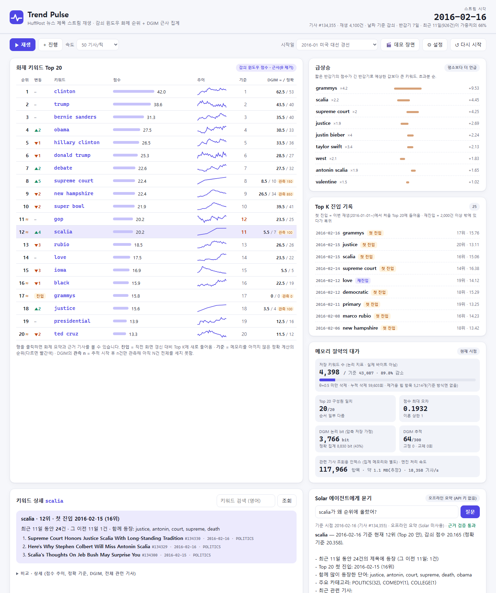

# Trend Pulse — 실시간 화제 키워드

> 빅데이터개론 그룹 프로젝트 · Team **cloudnine** · 프로토타입 v0.3
> 키워드 목록 없이 뉴스 제목 스트림에서 화제를 발견하고, **저장 키워드 수를 줄였을 때 어떤 순위 오류가 생기는지** 측정한다.

저장소: [legendkimofficial/TrendPulse](https://github.com/legendkimofficial/TrendPulse)



## 핵심 아이디어

| 구성 | 역할 | 교과 연결 |
|---|---|---|
| **감쇠 윈도우 + 제거** (주 기능) | 모든 키워드 점수를 감쇠시키고 새 기사에 나온 키워드는 +1, 점수가 θ 아래인 키워드는 삭제 → 최근 화제 순위 | 4주차 Exponentially Decaying Window |
| **정확 기준 방식** (비교용) | 같은 계산에서 삭제만 끈 버전(모든 키워드 유지) | — |
| **두 단어 묶기** (v0.3) | 인접한 두 키워드를 구로 함께 집계("donald trump", "supreme court"). 구가 대부분을 차지하는 단어는 순위에서 숨긴다 | — |
| **날짜 기준 감쇠** (v0.3 기본) | 기사 수 대신 날짜로 감쇠(반감기 7일). 기사가 적은 2018년 이후에도 화제를 바로 반영 | 감쇠 윈도우 변형 |
| **급상승** (v0.3) | 짧은 반감기 점수가 긴 반감기로 예상한 값보다 얼마나 큰지로 "평소보다 갑자기 늘어난" 키워드를 찾는다 | 감쇠 윈도우 2개 |
| **순위 불확실성 ≈** (v0.3) | 키워드별 오차 상한으로 "근사 때문에 순서가 바뀔 수 있는" 순위에만 표시(놓친 역전 0건 검증) | 오차 보장 |
| **DGIM** (보조 기능) | 추적 키워드가 **최근 N개 기사** 중 몇 개에 나왔는지 근사. 추적 시작 이후 기사만 센다 | 4주차 DGIM |
| **Upstage Solar 에이전트** | 통계·관련 기사 도구를 호출해 "왜 화제인가"를 설명. 인용한 기사 id는 앱이 조회 결과와 대조해 검증 | — |

## 빠른 시작

```bash
# 1) 가상환경 + 패키지 (Python 3.11 이상)
python -m venv .venv
.venv\Scripts\activate            # macOS/Linux: source .venv/bin/activate
pip install -r requirements.txt

# 2) 데이터 받기 (87MB, Kaggle 로그인 불필요)
python scripts/download_data.py

# 3) 대시보드 → http://127.0.0.1:5000   (발표 장면: http://127.0.0.1:5000/?demo=1)
python app.py

# (선택) Solar 에이전트 — 키가 없으면 같은 도구를 쓰는 오프라인 요약 모드
set UPSTAGE_API_KEY=up_xxx        # PowerShell: $env:UPSTAGE_API_KEY="up_xxx"
set UPSTAGE_MODEL=solar-pro2      # 선택, 기본값 solar-pro2

# 4) 테스트 / 실험
python -m unittest discover -s tests -t .      # 50개, 데이터 없이도 실행됨
python experiments/run_experiments.py          # E0~E6 (알고리즘 비교, 약 7분)
python experiments/run_sprint3.py              # E7~E11 (v0.3 기능, 약 3분)
python experiments/eval_agent.py               # 에이전트 평가 (키가 있으면 Solar, 없으면 오프라인 기준선)
```

처음 실행 시 정리·토큰화·구 추출 결과를 `data/processed/stream_v3.pkl`에 캐시한다(약 10초, 이후 1초 미만).
PowerShell에서 이 폴더로 이동할 때 경로에 `` ` ``가 있으면 작은따옴표로 감싼다: `cd 'D:\...\TrendPulse'`.

### 대시보드 사용법
- **▶ 재생 / Space**: 스트림 재생. 속도 = 틱(0.7초)당 기사 수.
- **🎬 데모 장면**: 발표 장면(2016-02-16, `scalia` 선택, 에이전트 질문)을 한 번에 복원.
- **시작일 프리셋**: 시작일 이전 구간으로 미리 채운(warm-up) 뒤 재생.
- **⚙ 설정**: 감쇠 단위(날짜 / 기사 수), 반감기 일수, c, θ, K, 두 단어 묶기, DGIM N·r. 잘못된 값은 400 오류로 거부되고 엔진 상태는 바뀌지 않는다.
- 순위표: **≈** = 근사 때문에 바로 위·아래(마지막 순위는 Top K 밖 키워드)와 순서가 바뀔 수 있음 · **진입** = 직전 화면 갱신 대비 Top K에 새로 들어옴 · **기준** = 정확 계산의 순위(다르면 빨간색) · DGIM **관측 n** = 추적 시작 후 n건만 관측.
- **급상승**: 평소보다 갑자기 많이 나온 키워드. ×배수 = 짧은 창 점수 ÷ 평소 비율로 예상한 점수, +값 = 초과분.
- **Top K 진입 기록**: **첫 진입** = 이번 재생에서 처음 Top K(warm-up 제외) · **재진입** = 일정 기간 밖에 있다가 복귀.
- 키워드 상세: 위에 **화제 요약(진입 시점, 최근/이전 구간 등장 수, 대표 기사 3건)**, 아래 접힌 영역에 비교·상세.
- 에이전트 답변: 기준 시점, 모드(Solar / 오프라인 요약 / Solar 대체), 근거 검증 결과. `[#id]`를 누르면 원문 기사가 열린다. 질문한 구가 아직 기사에 없으면 어떤 단어로 답했는지 경고로 알려 준다.

## 측정 용어 (발표·문서 공통)

| 용어 | 뜻 | 아닌 것 |
|---|---|---|
| **저장 키워드 수** | 집계가 들고 있는 키워드(단어·구) 개수(논리 지표) | 바이트 수 |
| **Python 객체 크기** | `trendpulse/memory.py`의 `deep_sizeof`로 잰 집계 자료구조(딕셔너리·키 문자열·float·**힙**) 바이트 | 기사 원문·관련 기사 인덱스·프로세스 전체 메모리 |
| **논리 bit** (DGIM) | 압축 저장을 가정한 모델: 버킷당 `log₂N + log₂log₂N` bit / 정확 쪽 `min(등장 수·log₂N, N)` bit | 실제 구현 크기 |
| **Top K 구성원 겹침** | 같은 시점 두 방식의 Top K 집합이 겹치는 비율(순서 무관) | 사람이 판단한 화제 적중률(→ 사례 평가) |
| **순서 동일** | Top K의 순서까지 정확 기준과 같은 시점의 비율 | 시간에 따른 순위 안정성 |
| **반감기** | 기사의 영향이 절반이 되는 데 걸리는 양. 기사 수 감쇠 c=0.001 → 693건, 날짜 감쇠 → 7일. 1/c는 대표 규모일 뿐 경계가 아니다 | 그 이전이 사라지는 창 |
| **사례 평가 성공** | 사건일부터 7일 안에 사건 표현(목록 중 하나)이 Top 20에 진입 | 사람 평가(→ casestudies.md 팀 평가 열) |
| **사전 등록 사건** | v0.3 실행 전에 사건·표현·기준을 정한 10개. 사후에 표현을 추가한 v0.2 사건 16개와 구분해 보고 | — |

## 주요 결과 (자세한 표: `experiments/results/summary.md`, `experiments/results/v03/summary.md`)

| 항목 | 결과 |
|---|---|
| 저장 키워드 수 (단어, 기사 수 감쇠, θ=0.5) | 2,854 / 40,265개 → **92.9% 감소** |
| Python 집계 객체 크기 (같은 설정) | 0.66 / 4.24 MB → **84.4% 감소** |
| Top 20 구성원 겹침 / 순서 동일 | **99.91%** (최저 95%) / **89.0%** |
| 두 단어 묶기 추가 시 | 근사 1.03 MB vs 정확 19.46 MB(**94.7% 감소**). 근사 쪽은 단어만일 때의 1.56배, 입력 갱신은 0.61배 속도 |
| 사례 평가 (26개, 사건일~7일 Top 20 진입) | 기사 수 감쇠 16/26 → **날짜 감쇠 23/26**. 사전 등록 10개만 보면 **3/10 → 9/10** |
| 급상승 Top 10 (사례 26개) | **24/26**이 7일 안에 진입, 17개 사건에서 Top 20보다 먼저. 급상승 목록의 48%는 그 시점 Top 20에 없는 키워드 |
| 순위 불확실성 ≈ | Top 20 인접 쌍 37,905개 중 **놓친 역전 0건**. 표시 비율 66.6%(전체 상한) → **2.4%**(키워드별 상한), 메모리 +29.6% |
| 처리 성능 (5회 중앙값) | 입력 갱신 194k 건/s(정확 684k) · Top 20 조회 0.51 ms(정확 11.35 ms) · 엔진 전체 v0.3 기본 20k 건/s |

## 프로젝트 구조

```
TrendPulse/
├─ app.py                     Flask 앱 팩토리 + REST API
├─ trendpulse/
│  ├─ text.py                 제목 토큰화 + 두 단어 구 추출
│  ├─ data.py                 로드·정리(빈 제목/중복 링크)·날짜순 정렬·캐시
│  ├─ decaying.py             감쇠 윈도우 (지연 감쇠, 힙 기반 제거, 일 단위 감쇠, 키워드별 오차 상한)
│  ├─ ranking.py              구 흡수, 순위 불확실성, 급상승 점수
│  ├─ dgim.py                 DGIM (r 파라미터, midpoint/textbook 추정)
│  ├─ sliding.py              효율적 정확 구간 집계 (DGIM 비교 대상)
│  ├─ engine.py               재생 엔진 (순위, 진입 이벤트, 급상승, DGIM 추적 정책, 인덱스)
│  ├─ memory.py               deep_sizeof / 프로세스 RSS
│  └─ agent.py                Solar 에이전트 (도구 호출 + 근거 검증 + 오프라인 모드)
├─ web/                       대시보드 (외부 CDN 없음, 다크 모드)
├─ experiments/
│  ├─ run_experiments.py      E0~E6 → results/ (summary.md, casestudies.md, figures/)
│  ├─ run_sprint3.py          E7~E11 → results/v03/
│  └─ eval_agent.py           에이전트 평가 → results/agent_eval/ (report.md에 사람 평가 칸)
├─ tests/                     50개 (brute-force 비교, 불확실성 보장, 엔진 정책, API, Solar mock)
├─ docs/                      발표 자료(slides.html → TrendPulse_발표.pdf), 발표 대본, 리뷰 문서
└─ PROGRESS.md                진행 상황 · 스프린트별 반영 내역
```

### API
| Method | Path | 설명 |
|---|---|---|
| GET | `/api/state` | 시각(감쇠 단위·반감기), 순위(≈ 표시·오차 상한 포함), 급상승, 진입 기록, 메모리·정확도 지표 |
| POST | `/api/step` `{n}` | 기사 n건 진행 (1~20,000) |
| POST | `/api/reset` `{start_date, decay_unit, half_life_days, phrases, c, threshold, k, dgim_n, dgim_r, burst_ratio, burst_min, ...}` | 설정 검증 후 재시작. 잘못된 값은 400, 상태 불변 |
| POST | `/api/demo` | 발표 장면 복원 |
| GET | `/api/keyword/<w>` | 화제 요약(활성 감쇠 단위 기준 최근/이전 구간), 점수 추이, DGIM, 함께 등장한 단어, 관련 기사. `w`에 구도 가능(`supreme court`) |
| POST | `/api/track` `{keyword}` | DGIM 추적 고정. 용량 초과 시 409 |
| POST | `/api/ask` `{question, keyword?}` | 에이전트 질문 → 답변, 기준 시점, 인용 목록(검증 결과), 도구 호출 기록, 경고 |

## 구현 규칙

### 전처리 규칙 (`text.py`)
- 제목만 집계하고 기사당 1회만 센다. 소문자, 길이 3 이상, 숫자 포함 토큰 제거, 하이픈 분리(`COVID-19` → `covid`), 소유격 제거.
- 불용어: 일반 영어 + 뉴스 제목 상투어(`photos`, `video`, `watch`, `says` …).
- 약어 유지(대소문자 구분): `AI`, `UK`/`U.K.` → `u.k.`, `EU`, `UN`, `US`/`U.S.` → `u.s.`. 제목 전체가 대문자이면 적용하지 않는다.
- **두 단어 구**(v0.3): 같은 절 안에서 바로 이웃한 두 키워드를 `"a b"`로 함께 센다. 구두점(`:`, `,`, `?`, 따옴표 …)이나 지워진 단어를 건너뛰지 않는다(`Trump: White House` → `white house`만). `new`는 불용어지만 구의 첫 단어는 될 수 있다(`new york`). 제목이 Title Case라 대소문자로는 이름을 찾을 수 없어, 자주 나오는 쌍은 남고 드문 쌍은 감쇠 윈도우가 지우는 방식에 맡긴다.
- **구 흡수**: 구의 점수가 그 안 단어 점수의 0.8배 이상이면 그 단어를 순위에서 숨긴다(`donald` → `donald trump`, `trump`는 유지).

### 데이터 정리 (`data.py`)
- 원본 209,527행 → 빈 제목 6건, 같은 링크 중복 41건(먼저 나온 것 유지) 제거 → **209,480건**.
- 같은 날짜·같은 제목이지만 링크가 다른 408건은 서로 다른 기사일 수 있어 유지(개수만 보고).
- 날짜만 있고 시각이 없어 같은 날짜 안 순서는 원본 파일 역순으로 고정한다(영향은 E5: 하루 끝 Top 20 겹침 99.3%).

### 감쇠 윈도우 (`decaying.py`)
- **지연 감쇠**: `v(w) = score(w)·g`로 저장하고 전역 계수 `g`만 키운다 → 모든 점수 감쇠가 O(1). 기사당 비용은 토큰 수만큼의 갱신, 힙 push/pop, 가끔의 재정규화·힙 정리다.
- **감쇠 단위**: `add(keywords, steps)`의 `steps`만큼 감쇠한다. 기사 수 감쇠는 기사마다 1, 날짜 감쇠는 이전 기사와의 날짜 차(같은 날 0).
- **제거**: `score < θ ⇔ v < θ·g` 이므로 최소 힙 맨 위만 확인해 기사마다 교과서 방식대로 삭제한다. 오래된 힙 항목이 `1.2 × 키워드 수 + 1024`를 넘으면 정리한다.
- **오차 상한**: 전체 상한은 제거로 잃는 점수 < `θ/(1-θ)`. v0.3은 키워드가 (다시) 들어온 시점을 기억해 **키워드별 상한** `θ/(1-θ)·(1-c)^경과`를 계산한다(키워드당 숫자 1개, 객체 크기 +29.6%). 오래 머문 키워드는 사실상 정확하다.
- 순위 동점은 키워드 문자열로 정렬해 결과를 재현 가능하게 한다(구가 그 첫 단어보다 앞에 온다).

### 순위 불확실성 (`ranking.py`)
- 정확 점수는 `[s, s + e)`(e = 키워드별 상한) 안에 있다. 이웃한 i, i+1은 `s_i < s_{i+1} + e_{i+1}`일 때만 정확 계산에서 순서가 바뀔 수 있으므로 그때만 ≈를 표시한다. 마지막 순위는 그 아래 키워드 중 따라잡을 수 있는 모든 키워드(점수가 전체 상한 이내)와 비교한다.
- 보장 범위: **원점수 순위**에 대한 보장이다. 구 흡수로 숨겨지는 단어가 정확 계산과 달라지는 경우는 포함하지 않는다.

### 급상승 (`ranking.py`)
- 같은 감쇠 단위로 반감기가 1/7인 짧은 창을 하나 더 둔다. 꾸준히 비율 p로 나오는 키워드의 점수는 짧은 창 ≈ p/c_s, 긴 창 ≈ p/c_l 이므로 `예상 = 긴 점수 × c_l / c_s`, **초과분 = 짧은 점수 − 예상**으로 순위를 매기고 `배수 = 짧은 점수 / 예상`을 보여 준다.
- 짧은 창 점수 3 미만은 제외한다(한두 번 나온 단어 방지). 긴 창 점수는 최소 1로 본다.

### DGIM 추적 정책 (`engine.py`)
- Top K에 들어온 키워드는 자동 추적하고, 사용자는 키워드를 고정할 수 있다. 용량 `max_tracked`(기본 300)는 자동·사용자 추적에 함께 적용한다.
- 현재 Top K와 고정 키워드는 교체하지 않는다. 가득 차면 Top K를 떠난 지 가장 오래된 자동 추적을 교체한다. 고정은 용량의 절반까지.
- 다시 추적하면 관측이 처음부터 다시 시작되고 "n번째 추적(관측 초기화)"로 표시한다. 추적 시작 이전 기사는 세지 않는다(설계상 결정).
- 추정: midpoint(가장 오래된 버킷의 참값 범위 `[합-크기+1, 합]`의 중앙값).

### Solar 근거 검증 (`agent.py`)
1. 첫 요청은 `tool_choice="required"`로 도구 호출을 강제한다.
2. 키워드 질문이면 `search_related_news` 조회와 1개 이상의 인용이 필요하다. 인용 id는 모두 이번 세션 도구 결과에 있어야 한다.
3. 실패하면 1회 재작성시키고, 그래도 실패하면 검증되지 않은 답변은 버리고 오프라인 요약을 경고와 함께 보여 준다.
4. 도구는 호출할 때만 엔진 잠금을 잡고, 기사는 질문 시점(`as_of`)까지만 조회한다.
5. 질문의 구가 아직 기사에 없으면(예: 사건 직후의 `george floyd`) 어떤 단어로 답했는지 경고로 알린다.
- **검증 범위**: 위 흐름은 mock 테스트와 오프라인 기준선(`eval_agent.py`)으로 확인했다. 실제 Upstage API로는 아직 호출하지 않았다.

## 데이터와 해석의 한계
- 데이터: [News Category Dataset](https://www.kaggle.com/datasets/rmisra/news-category-dataset) (Rishabh Misra, CC BY 4.0), HuffPost 2012-01-28 ~ 2022-09-23.
- 순위는 HuffPost 데이터 안에서 관찰한 화제이며 사회 전체의 관심도를 뜻하지 않는다. 과거 데이터 재생이며 실제 실시간 수집이 아니다.
- 2018년 이후 하루 기사가 약 5건으로 줄어든다. 날짜 감쇠는 화제를 바로 반영하지만, 최근 7일 기사가 2건 이하인 "근거가 얇은" 키워드가 Top 20의 73~78%를 차지한다(기사 수 감쇠는 81~88%).
- 처리 성능은 실행 환경에 따라 달라진다(실행마다 ±10~30%).

## 공유 파일 범위

- 코드, 테스트, 실험 결과(JSON·표·그래프), 발표 PDF·HTML·대본, 진행 보고와 과거 리뷰를 포함한다. v0.3 실험 결과는 `experiments/results/v03/`, 에이전트 평가는 `experiments/results/agent_eval/`에 있다.
- 가상환경(`.venv/`), 원본 데이터(`data/raw/`), 토큰 캐시(`data/processed/`), API 키·로컬 설정은 `.gitignore`로 제외한다. 원본 데이터는 빠른 시작의 다운로드 스크립트로 받고 캐시는 실행 시 생성한다.
- 작업 폴더 상위의 초기 기획안과 대화·설명 스크린샷은 이 저장소에 포함하지 않는다.
- `docs/FEEDBACK_2026-11-08.md`는 v0.1 검토 기록이며, 현재 반영 상태와 남은 작업은 `PROGRESS.md`에 정리되어 있다.
