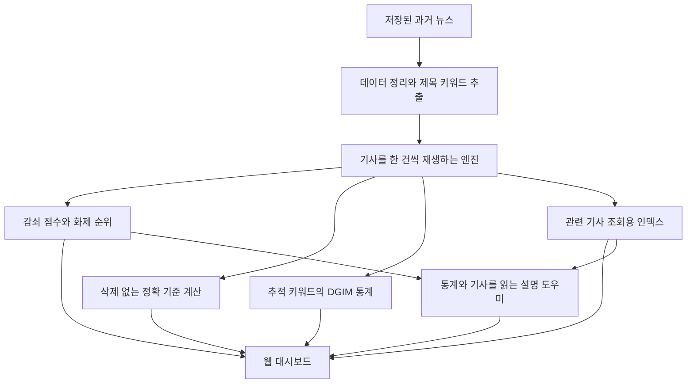

# TrendPulse 프로젝트 이해 가이드

> 대상: 프로젝트가 무엇을 만드는지부터 이해하고 싶은 팀원
>
> 기준: 2026-11-09, 현재 저장소의 프로토타입 v0.4 코드와 저장된 실험 결과

이 문서는 **주제와 목적을 먼저 이해하고, 그다음 계산 원리와 코드를 공부하기 위한 자료**다. 처음에는 1~3절을 읽고 큰 그림을 잡자. 이어서 4~10절에서 원리를 공부하고, 11~16절에서 화면·실험·실행 방법과 연결하면 된다.

설명용으로 만든 예시는 따로 표시했다. 실험 수치는 저장된 결과에서 가져왔으며, 이번 문서 작성 과정에서 전체 실험을 다시 실행한 것은 아니다. 로컬 데이터의 건수·기간과 기존 테스트 67개 통과는 직접 확인했다.

---

## 1. 우리 프로젝트의 주제는 무엇인가?

**TrendPulse는 계속 들어오는 뉴스 제목에서 최근 화제 키워드를 자동으로 찾아 보여 주고, 오래된 키워드를 잊어 저장 공간을 줄이면 순위가 얼마나 달라지는지 검증하는 프로젝트다.**

프로젝트 이름에서 Trend는 화제의 흐름, Pulse는 현재의 움직임을 관찰한다는 의미로 이해하면 된다.

우리가 만드는 결과물은 다음 세 가지가 연결된 프로그램이다.

| 결과물 | 하는 일 | 필요한 이유 |
|---|---|---|
| 뉴스 스트림 분석 엔진 | 제목을 한 건씩 읽어 키워드 점수·순위·급상승을 갱신한다 | 데이터가 계속 들어올 때 최근 화제를 계산하기 위해 |
| 비교·평가 도구 | 키워드를 지우는 계산과 지우지 않는 계산을 비교한다 | 저장 공간을 줄인 대가가 얼마나 큰지 확인하기 위해 |
| 웹 대시보드와 설명 도우미 | 순위 변화, 관련 기사, 오차, 키워드 설명을 보여 준다 | 계산 결과를 사람이 이해하고 확인할 수 있게 하기 위해 |

수업 프로젝트로서의 중심 질문은 다음과 같다.

> **“모든 키워드를 계속 기억하지 않아도, 최근 화제의 순위를 충분히 비슷하게 유지할 수 있을까?”**

단순히 순위표를 만드는 것에서 한 단계 더 나아가, **저장량과 정확도 사이의 관계를 직접 측정하는 것**이 핵심이다.

## 2. 왜 이런 프로젝트가 필요한가?

### 2.1 전체 기간의 등장 횟수만 세면 생기는 문제

가령 어떤 단어가 몇 년 동안 많이 등장했지만 최근에는 거의 나오지 않는다고 하자. 다른 단어는 예전에는 드물었지만 며칠 사이에 집중적으로 등장한다.

전체 누적 횟수만 비교하면 오래전부터 자주 나오던 단어가 계속 유리하다. 우리가 알고 싶은 **“지금 무엇이 화제인가?”**와 계산 결과가 달라질 수 있다.

그래서 최근 기사에는 큰 가중치를, 오래된 기사에는 작은 가중치를 주는 **감쇠 점수**를 사용한다.

### 2.2 등장한 키워드를 전부 기억하면 생기는 문제

뉴스가 쌓일수록 인명·지명·기관·사건 표현이 계속 추가된다. 한 번만 나온 표현까지 모두 보관하면 집계 자료구조가 커지고, 순위를 조회할 때 살펴봐야 할 후보도 늘어난다.

그래서 점수가 아주 낮아진 키워드는 집계에서 삭제한다. 여기에는 대가가 있다. 지운 키워드가 나중에 다시 등장하면 예전에 남아 있던 작은 점수를 기억하지 못한다.

따라서 **덜 기억하면 공간을 절약할 수 있지만, 점수와 순위에 오차가 생길 수 있다.** 이 관계를 검증하는 것이 프로젝트의 실험 목적이다.

### 2.3 키워드 목록은 미리 정하는가?

화제 탐지에 사용할 주제 목록을 미리 정하지 않는다. 제목에서 조건에 맞는 단어와 두 단어 구를 자동으로 추출한다. 새로운 표현이 등장하면 그 표현도 집계 후보가 된다.

단, 전처리에는 미리 정한 **불용어 목록**이 있다. `the`, `and`처럼 주제를 설명하기 어려운 단어를 제거하기 위한 규칙이다. 또 실험에는 성능을 확인하기 위한 **사건·표현 목록**이 있다. 이 평가 목록을 엔진에 넣어 해당 사건을 찾도록 지시하는 구조는 아니다.

### 2.4 사용자는 무엇을 할 수 있는가?

예를 들어 과거 뉴스의 특정 날짜로 이동한 뒤 다음 과정을 따라갈 수 있다.

1. 현재 뉴스에서 점수가 높은 키워드를 확인한다.
2. 새로 순위에 들어오거나 급상승한 키워드를 찾는다.
3. 키워드를 눌러 관련 기사와 최근 등장 수를 확인한다.
4. 키워드를 지우지 않고 계산한 순위와 비교한다.
5. “이 키워드가 왜 화제야?”라고 질문해 통계와 기사를 바탕으로 한 설명을 읽는다.

## 3. 현재 구현의 전체 그림

현재 프로그램은 **HuffPost의 과거 뉴스를 날짜순으로 재생하는 로컬 웹 애플리케이션**이다. 저장된 기사들을 한 건씩 처리하면서, 새 뉴스가 계속 들어오는 상황을 재현한다.



그림이 표시되지 않는 뷰어에서는 다음 흐름으로 읽으면 된다.

```text
과거 뉴스 → 정리·제목 전처리 → 한 건씩 처리 → 순위·통계·비교 → 화면과 설명
```

각 기능의 책임을 구분하면 전체 구조가 훨씬 쉬워진다.

| 기능 | 답하는 질문 | 구현 방식 |
|---|---|---|
| 화제 순위 | 최근성을 고려했을 때 어떤 키워드의 언급이 많은가? | 긴 감쇠 윈도우 |
| 정확 비교 | 키워드를 삭제하지 않았다면 점수와 순위가 어땠을까? | 삭제 없는 같은 감쇠 계산 |
| 급상승 | 평소 수준에 비해 갑자기 언급이 늘었는가? | 긴 감쇠 집계와 짧은 감쇠 집계 비교 |
| DGIM | 이 추적 키워드가 최근 N개 기사 중 몇 개에 나왔는가? | 버킷을 이용한 근사 횟수 집계 |
| 관련 기사 | 어떤 기사 제목에서 이 키워드가 나왔는가? | 키워드별 기사 번호 목록 조회 |
| 설명 도우미 | 이 수치와 기사 내용을 사람이 이해하게 설명하면? | 선택적 Solar 호출 또는 오프라인 요약 |

**순위와 통계를 만드는 부분은 Python 알고리즘이다.** Solar는 계산 결과와 기사 정보를 읽어 설명하는 역할이다. 뉴스 본문으로 모델을 학습하거나, 언어모델이 직접 화제 순위를 결정하는 구현은 없다.

현재 코드에는 최신 뉴스를 지속 수집하는 기능이 없다. 화면의 현재 시각도 컴퓨터의 오늘 날짜가 아니라 **마지막으로 처리한 기사의 날짜**다.

앞으로 나올 용어는 다음 뜻으로 읽으면 된다.

| 용어 | 쉬운 뜻 |
|---|---|
| 스트림 | 순서대로 계속 도착하는 데이터. 여기서는 한 건씩 재생하는 기사 |
| 키워드 | 제목에서 추출한 단어 또는 두 단어 구 |
| Top K | 순위의 상위 K개. 기본 K는 20 |
| 근사 | 정보를 일부 줄여 저장하고, 그에 따른 계산 오차를 허용하는 방식 |
| 스냅샷 | 특정 처리 시점의 순위 등을 기록한 상태 |
| 인덱스 | 키워드로 관련 기사 위치를 빠르게 찾기 위한 목록 |

---

## 4. 입력 데이터와 전처리는 어떻게 구성되는가?

### 4.1 사용하는 데이터

| 항목 | 현재 데이터 |
|---|---|
| 출처 | HuffPost News Category Dataset v3 |
| 원본 행 수 | 209,527행 |
| 정리 후 기사 수 | 209,480건 |
| 기간 | 2012-01-28 ~ 2022-09-23 |
| 주요 필드 | 날짜, 제목, 짧은 설명, 카테고리, 링크 |
| 순위 점수에 직접 사용하는 내용 | 제목에서 추출한 단어·구 |

빈 제목 6건과 중복 링크 41건을 제거한다. 같은 날짜·같은 제목이어도 링크가 다른 추가 408건은 남긴다. 서로 다른 기사일 수 있기 때문이다.

데이터에는 날짜만 있고 시·분·초는 없다. 같은 날짜 안의 순서는 원본 파일의 역순을 유지하도록 고정했다. 따라서 하루 중 실제 발행 순서까지 복원한 데이터로 이해하면 안 된다.

구현 근거: [data.py](../trendpulse/data.py)의 `Article`, `_build()`, `load_stream()`.

### 4.2 제목을 키워드로 바꾸기

주요 규칙은 다음과 같다.

- 영어를 소문자로 정리하고 소유격 등을 처리한다.
- 일반 불용어와 `video`, `photos`, `says` 같은 뉴스 상투어를 제거한다.
- 일반적으로 길이 3 미만이거나 숫자가 포함된 토큰은 제외한다.
- `AI`, `US`, `UK`, `EU`, `UN` 등은 약어 예외로 보존한다. 예를 들어 `US`는 `u.s.`로 구분한다.
- **같은 제목 안에서 같은 키워드가 여러 번 나와도 해당 기사에서는 1번만 센다.**

마지막 규칙은 중요하다. 우리가 세는 기본 입력은 단어의 반복 횟수가 아니라 **그 키워드가 등장한 기사 여부**다.

### 4.3 두 단어 구를 함께 세는 이유

`donald`와 `trump`를 따로만 보면 같은 인물에 대한 순위가 여러 줄을 차지할 수 있다. `supreme court`도 두 단어를 함께 볼 때 의미가 더 명확하다.

그래서 원래 제목에서 바로 이웃한 유효 단어 두 개를 구로 추출한다. 설명용 제목을 실제 전처리 함수에 넣으면 다음과 같다.

```text
제목: Donald Trump Visits New York

단어: donald, trump, visits, york
구:   donald trump, trump visits, new york
```

`new`는 단어 집계에서는 불용어지만 `new york`처럼 구의 첫 단어로는 허용한다.

이 예에서 `trump visits`도 추출된다는 점을 보자. **구 추출은 인물·장소의 의미를 이해한 결과가 아니라 인접한 단어를 묶는 규칙**이다. 불필요한 구도 생길 수 있으며, 드문 구는 감쇠와 삭제 과정에서 줄어든다. 구두점이나 제거된 단어를 건너뛰어 구를 만들지는 않는다.

### 4.4 구 흡수: 화면에서 겹치는 단어 숨기기

설명용으로 다음 점수를 가정하자.

```text
donald       30
trump        70
donald trump 28
```

기본 흡수 비율은 0.8이다. 구 점수가 그 안의 단어 점수의 80% 이상이면 그 단어를 순위에서 숨긴다.

- `28 ≥ 30 × 0.8`이므로 `donald`는 숨긴다.
- `28 < 70 × 0.8`이므로 `trump`는 남긴다.

단어의 점수를 구에 더하는 연산이 아니다. 집계 자료구조에서 단어를 삭제하지도 않는다. **표시할 순위에서 중복을 줄이는 규칙**이다. 현재 엔진은 점수 상위 `3K`개 후보에 이 규칙을 적용한 뒤 K개를 보여 준다.

구현 근거: [text.py](../trendpulse/text.py)의 `tokenize()`, `phrases()`, [ranking.py](../trendpulse/ranking.py)의 `absorb()`.

## 5. 핵심 원리 ①: 최근 기사를 더 중요하게 보는 감쇠 점수

### 5.1 가장 중요한 계산식

키워드 하나의 점수는 기사를 처리할 때마다 다음처럼 갱신된다.

```text
새 점수 = 이전 점수 × (1 - c)^Δ + 이번 기사 등장 여부
```

| 기호 | 뜻 |
|---|---|
| `c` | 한 단위가 지났을 때 영향이 줄어드는 정도, 0과 1 사이 |
| `Δ` | 이번 기사까지 몇 단위가 지났는지 |
| 등장 여부 | 이번 제목에 해당 키워드가 있으면 1, 없으면 0 |

`c`가 클수록 과거의 영향이 빨리 줄어든다. 점수는 과거 기사들의 기여를 가중해서 더한 값이므로 `12.37`처럼 소수가 된다.

정확 기준 점수를 수식으로 쓰면 다음과 같다.

```text
S_T(w) = Σ [기사 i에 w가 있으면 1, 없으면 0] × (1-c)^(T-u_i)
```

`w`는 키워드, `u_i`는 기사 i의 처리 위치 또는 날짜, `T`는 현재 위치 또는 날짜다. 지금까지 처리한 기사 각각이 얼마나 오래되었는지에 따라 작은 점수를 보태는 식이다.

### 5.2 현재 기본값: 날짜 기준, 반감기 7일

반감기는 **기사 한 건이 점수에 주는 영향이 절반으로 줄어드는 기간**이다.

| 기사가 지난 기간 | 그 기사 1건이 현재 점수에 기여하는 양 |
|---|---:|
| 당일 | 1 |
| 7일 | 0.5 |
| 14일 | 0.25 |
| 21일 | 0.125 |

반감기 7일에 맞는 날짜 단위 감쇠상수는 다음과 같다.

```text
c = 1 - 0.5^(1/7) ≈ 0.0942763
```

날짜 모드에서는 `Δ`가 이전 기사와 이번 기사의 날짜 차이다. 같은 날짜의 기사끼리는 `Δ=0`이므로 서로 사이에 감쇠가 없다. 다음 날짜의 기사를 처리할 때 날짜 차이를 반영한다. 재생을 멈춘 채 실제 시간이 흘러도 점수가 저절로 바뀌지는 않는다.

### 5.3 기사 수 기준과 날짜 기준의 차이

| 방식 | 무엇이 지나면 감쇠하는가? | 현재 설정 예시 |
|---|---|---|
| 기사 수 기준 | 기사 한 건마다 | `c=0.001`, 반감기 약 693건 |
| 날짜 기준 | 기사 날짜가 하루 지날 때마다 | 반감기 7일, 현재 기본 |

하루에 100건이 들어오면 1,000건은 약 10일이다. 하루에 5건이면 1,000건은 약 200일이다. 같은 기사 수 구간이라도 달력상 최근성은 크게 달라진다.

이 데이터는 2018년 이후 기사 밀도가 크게 낮아진다. 기사 수 기준으로만 잊으면 몇 달 전 기사도 최근 순위에 오래 영향을 줄 수 있어, 날짜 기준 감쇠를 기본값으로 도입했다.

**7일 전 기사를 한꺼번에 버리는 구조는 아니다.** 오래된 영향은 계속 작아진다. 이런 방식을 지수 감쇠 윈도우라고 한다. 최근 N건 밖을 경계에서 제외하는 DGIM 구간과 구분하자.

구현 근거: [decaying.py](../trendpulse/decaying.py)의 `DecayingWindow.add()`, [engine.py](../trendpulse/engine.py)의 `EngineConfig.decay_c`, `_ingest()`.

## 6. 핵심 원리 ②: 작은 점수를 삭제해 공간 절약하기

### 6.1 근사 방식과 정확 기준 방식

엔진은 같은 기사를 두 방식으로 동시에 처리한다.

| 방식 | 감쇠 계산 | 작은 점수의 키워드 삭제 | 용도 |
|---|---|---|---|
| 근사 집계 `pruned` | 적용 | 적용 | 주 순위와 저장 공간 절약 |
| 정확 기준 `baseline` | 적용 | 적용하지 않음 | 삭제 때문에 생긴 오차 측정 |

기본 삭제 임계값 `θ`는 0.5다. **기사의 감쇠와 등장 점수 추가를 처리한 뒤 점수가 θ보다 작은 키워드를 집계에서 지운다.** 정확히 θ인 항목은 남는다.

정확 기준도 과거 점수를 감쇠한다. 차이는 삭제 여부다. 또한 여기서 정확하다는 말은 **같은 점수 정의를 삭제 손실 없이 계산한다**는 뜻이다. 사람이 판단한 뉴스의 중요도가 정답이라는 뜻은 아니다.

### 6.2 손으로 따라가는 예시

다음은 계산을 쉽게 보이기 위한 **설명용 설정**이다. 실제 기본 감쇠상수 대신 기사마다 절반으로 줄어드는 `c=0.5`, 삭제 임계값 `θ=0.5`를 사용한다.

| 처리 기사 | 정확 alpha | 근사 alpha | 근사 beta |
|---|---:|---:|---:|
| 1: alpha 등장 | 1 | 1 | 0 |
| 2: beta 등장 | 0.5 | 0.5 | 1 |
| 3: beta 등장 | 0.25 | 0, 삭제됨 | 1.5 |
| 4: beta 등장 | 0.125 | 0 | 1.75 |
| 5: alpha 등장 | 1.0625 | 1 | 0.875 |

5번째 기사에서 차이가 드러난다.

```text
정확 alpha = 0.125 × 0.5 + 1 = 1.0625
근사 alpha = 지운 과거 점수를 기억하지 못하므로 0 + 1 = 1
```

근사는 작아진 이력을 버려 저장 공간을 절약했다. 대신 다시 등장했을 때 정확 점수보다 조금 작게 계산했다. 이 예시는 실제 `DecayingWindow` 실행으로 확인했다.

삭제는 **그 키워드의 집계 점수에 대한 삭제**다. 관련 기사 원본이나 기사 검색용 인덱스까지 함께 지우는 동작은 아니다.

### 6.3 오차를 어디까지 허용하는가?

이 삭제 방식의 점수는 정확 점수를 과소 추정한다. 코드에서 사용하는 전체 오차 상한은 다음과 같다.

```text
0 ≤ 정확 점수 - 근사 점수 < θ / (1 - θ)
```

기본 `θ=0.5`에서는 상한이 1이다. **점수 차이가 1 미만이라는 뜻이며 오차율 1%라는 뜻이 아니다.**

삭제 순간 잃는 값은 θ보다 작다. 한 번 삭제된 키워드가 다시 삭제되려면, 재등장해서 최소 1이 된 점수가 다시 θ 미만으로 줄어야 한다. 그동안 이전 손실도 함께 감쇠하므로 누적 손실을 `θ + θ² + θ³ + … = θ/(1-θ)`로 제한할 수 있다.

임계값을 크게 하면 더 많은 키워드를 지울 수 있지만, 허용되는 점수 손실도 커진다. 점수 차이가 작은 키워드끼리는 작은 손실로도 순위가 바뀔 수 있다.

### 6.4 모든 점수를 매번 곱하면 느리지 않을까?

실제 구현은 **지연 감쇠**를 사용한다. 각 점수를 매번 직접 줄이는 대신 공통 배율을 관리한다.

```text
실제 점수 s(w) 대신 v(w) = s(w) × g 를 저장
실제 점수를 읽을 때 s(w) = v(w) / g
```

감쇠할 때 전역값 `g`만 키우면 모든 `v/g`가 작아지는 효과가 난다. 이번 기사에 등장한 키워드는 저장값 `v`에 현재 `g`를 더하면 실제 점수에 1을 더한 효과가 난다.

삭제할 항목은 값이 작은 순서로 꺼내는 **최소 힙**으로 찾는다. 내부 삭제 조건은 `v < θ×g`다. 값이 너무 커지면 재정규화하고, 갱신으로 낡은 힙 항목이 많이 쌓이면 정리한다.

여기서 O(1), 즉 키워드 수와 무관하게 처리한다는 설명은 **공통 감쇠 반영**에 해당한다. 기사 한 건 처리 전체에는 그 기사에 나온 키워드 수만큼의 갱신, 힙 관리, 가끔의 정리 비용이 있다. 순위 조회도 저장된 후보를 살펴보므로 저장 키워드 수가 중요하다.

구현 근거: [decaying.py](../trendpulse/decaying.py)의 `add()`, `_prune()`, `_rebase()`, `error_bound()`.

## 7. 보조 원리 ①: DGIM으로 최근 N개 기사 등장 횟수 추정하기

### 7.1 감쇠 점수와 다른 질문

감쇠 순위는 최근성을 가중한 점수로 화제를 찾는다. DGIM은 추적 중인 키워드에 대해 **“최근 N개 기사 중 이 키워드가 나온 기사는 몇 개인가?”**를 추정한다.

키워드 하나를 골라 각 기사를 다음처럼 생각하자.

```text
등장하면 1, 등장하지 않으면 0
예: 1 0 1 1 0 1 0 1 0 1 1 0
```

최근 N개 기사에 해당하는 0/1 기록을 모두 직접 기억하는 대신 여러 1을 버킷으로 묶는다. 버킷은 **묶인 1의 개수와 그중 가장 최근 1의 기사 위치**를 저장한다.

### 7.2 버킷을 만드는 규칙

1. 키워드가 등장하면 크기 1 버킷을 추가한다.
2. 버킷 크기는 1, 2, 4, 8처럼 2의 거듭제곱이다.
3. 같은 크기의 버킷이 허용 개수 `r`을 넘으면 가장 오래된 두 개를 합친다.
4. 합친 버킷은 두 배의 크기와, 두 버킷 중 더 최근의 위치를 갖는다.
5. 가장 최근 위치까지 최근 N건 밖으로 나간 버킷은 제거한다.

기본값은 `N=1000`, `r=2`다. 등장하지 않은 0은 별도로 저장하지 않고 현재 기사 번호로 구간을 판단한다.

### 7.3 왜 근사값인가?

가장 오래된 버킷 안의 일부 1이 최근 N건 밖에 있을 수 있다. 버킷 내부의 개별 위치는 잊었기 때문에 정확한 개수를 알 수 없다.

현재 기본인 midpoint 추정은 다음 식을 쓴다.

```text
추정 횟수 = 모든 버킷 크기의 합 - (가장 오래된 버킷 크기 - 1) / 2
```

앞의 설명용 비트열에서 `N=8`, 현재 위치를 12라고 하면 실제 최근 구간은 5~12번째 기사다. 실제 등장 횟수는 4다. 코드가 보관하는 버킷은 최신부터 다음과 같다.

```text
[가장 최근 위치, 크기]: [11, 1], [10, 2], [6, 2]
추정 = (1 + 2 + 2) - (2 - 1)/2 = 4.5
실제 = 4
```

이 예시도 실제 클래스 실행으로 확인했다. **DGIM 값은 소수일 수 있고, 실제보다 크거나 작을 수 있다.** 감쇠 집계의 삭제 오차가 과소 추정인 것과 다르다.

기본 midpoint의 상대오차 상한은 `1 / [2(r-1)]`이다. `r=2`에서는 50%, `r=3`에서는 25%다. r을 키우면 버킷을 더 보관하는 대신 상한을 줄일 수 있다.

### 7.4 추적 시작 시점에 주의하기

전체 키워드에 DGIM을 항상 붙이는 것은 아니다. 스냅샷에서 Top K에 오른 키워드를 자동 추적하거나, 사용자가 키워드를 고정해 추적한다.

**추적 시작 이전의 기사는 소급해서 세지 않는다.** 막 발견한 키워드는 감쇠 점수가 높아도 DGIM 값이 0이거나 작을 수 있다. 화면의 관측 기사 수를 함께 읽어야 한다. 추적기를 교체했다가 다시 추적하면 관측이 초기화된다.

날짜 기준 감쇠 모드에서도 DGIM의 N은 **날짜가 아니라 기사 개수**다. DGIM 옆의 정확 횟수는 같은 추적 시작 시점부터 최근 N건을 정확히 센 비교값이다.

구현 근거: [dgim.py](../trendpulse/dgim.py)의 `add()`, `estimate()`, [sliding.py](../trendpulse/sliding.py)의 `ExactWindowCount`, [engine.py](../trendpulse/engine.py)의 `track()`, `dgim_info()`.

## 8. 보조 원리 ②: 인기와 급상승 구분하기

화제 순위가 높다는 것은 최근성을 고려한 언급량이 많다는 뜻이다. 급상승은 **평소 수준에 비해 갑자기 언급이 늘었다**는 뜻이다. 평소에도 자주 나오는 키워드는 순위가 높아도 급상승이 아닐 수 있다.

이를 위해 같은 기사를 두 감쇠 집계에 넣는다.

| 집계 | 기본 날짜 모드의 반감기 | 역할 |
|---|---:|---|
| 긴 집계 | 7일 | 비교적 긴 흐름 |
| 짧은 집계 | 1일 | 빠른 변화 |

감쇠 한 단위마다 일정한 평균 언급량 `p`가 들어온다고 가정하면 점수는 대략 `p/c`가 된다. 기사 수 모드에서는 기사 한 건당 평균 등장량, 날짜 모드에서는 하루당 평균 등장량을 뜻한다. 이 관계를 이용해 긴 점수로부터 짧은 점수의 예상 수준을 계산한다.

```text
예상 짧은 점수 = max(긴 점수, 1) × 긴 c / 짧은 c
초과분 = 실제 짧은 점수 - 예상 짧은 점수
배수 = 실제 짧은 점수 / 예상 짧은 점수
```

설명용으로 긴 점수 20, 짧은 점수 8이라면 기본 날짜 설정에서 다음과 같다.

```text
예상 ≈ 20 × 0.0942763 / 0.5 ≈ 3.77
초과분 ≈ 8 - 3.77 = 4.23
배수 ≈ 8 / 3.77 = 2.12배
```

기본적으로 짧은 점수 3 미만은 제외하고, 초과분이 양수인 후보를 **초과분 순서**로 보여 준다. 배수 자체로 정렬하는 것은 아니다. 짧은 점수도 가중합이므로 “최근 기사 3건”과 같은 조건은 아니다.

이 값은 두 감쇠 집계로 만든 변화 지표다. 통계적 유의성이나 미래의 화제화를 보장하는 확률로 해석하지 않는다. 기사가 적은 구간에서는 짧은 점수가 기준에 못 미쳐 목록이 비기도 한다.

구현 근거: [ranking.py](../trendpulse/ranking.py)의 `burst_scores()`, [engine.py](../trendpulse/engine.py)의 `short_c`, `burst()`.

## 9. 보조 원리 ③: 순위 옆의 ≈는 무엇인가?

삭제로 잃는 점수가 작아도 서로 가까운 두 키워드의 순서는 바뀔 수 있다. 그래서 키워드별 오차 상한을 이용해 순서가 바뀔 가능성이 있는 곳에 `≈`를 표시한다.

설명용으로 다음을 가정하자.

```text
A: 근사 점수 10.0
B: 근사 점수  9.8, 오차 상한 0.3
```

B의 정확 점수는 9.8 이상 10.1 미만일 수 있다. A보다 높을 가능성이 남아 있으므로 순서가 확실하다고 말할 수 없다. 반대로 B의 오차 상한이 0.1이라면 정확 점수도 9.9 미만이므로 A를 넘지 못한다.

엔진은 키워드가 마지막으로 집계에 들어온 시점을 기억한다. 그 뒤에는 근사와 정확에 같은 점수가 추가되고 기존 손실만 줄어드므로 다음 상한을 사용할 수 있다.

```text
키워드별 상한 = 전체 상한 × (1-c)^(마지막 삽입 후 경과 단위)
```

오래 유지된 키워드는 상한도 작아진다. 마지막 순위는 Top K 밖의 키워드가 따라잡을 가능성도 검사한다.

`≈`는 **삭제 오차로 순서가 달라질 수 있다는 표시**다. 실제로 이미 역전되었다는 뜻도, 그 화제가 사실인지 의심스럽다는 뜻도 아니다. 보장 범위는 원점수 순위이며, 구 흡수에서 어떤 단어를 숨길지 달라지는 경우까지 포함하지 않는다.

구현 근거: [decaying.py](../trendpulse/decaying.py)의 `key_error()`, [ranking.py](../trendpulse/ranking.py)의 `uncertainty()`, `outside_candidates()`.

## 10. 설명 도우미와 Solar는 어떻게 동작하는가?

### 10.1 통계를 읽는 도구 세 가지

도우미는 다음 도구를 통해 엔진의 데이터를 읽는다.

| 도구 | 조회 내용 |
|---|---|
| `get_top_keywords` | 현재 순위와 최근 진입 기록 |
| `get_keyword_stats` | 특정 키워드 점수·순위·최근/이전 횟수·DGIM 등 |
| `search_related_news` | 해당 키워드가 나온 기사의 제목·짧은 설명 등 |

여기서 기사 검색은 **로컬 데이터의 인덱스 조회**다. 질문할 때 인터넷에서 새 기사를 검색하는 동작은 아니다.

### 10.2 API 키가 있을 때

1. 질문과 도구 정의를 Solar에 전달한다.
2. 모델이 요청한 도구를 Python 코드가 실행한다.
3. 통계와 기사 조회 결과를 모델에 전달한다.
4. 모델이 설명을 작성한다.
5. 답변의 `[#기사번호]`가 이번 도구 조회 결과에 실제로 있었는지 검사한다.

첫 모델 요청에는 도구 호출을 요구한다. 특정 키워드에 대한 질문에는 해당 키워드 기사 조회를 요구하고, 조회한 기사가 있으면 인용도 요구한다. 검증 실패 시 한 번 수정을 요청하며, 다시 실패하거나 API 오류가 나면 오프라인 요약으로 대체한다.

**인용 검증은 기사 번호의 유효성과 조회 절차를 검사하는 장치다.** 해당 기사가 답변의 모든 문장을 실제로 뒷받침하는지, 설명한 인과관계가 맞는지까지 자동 증명하지는 않는다.

### 10.3 API 키가 없을 때

같은 도구에서 가져온 데이터를 정해진 문장 형식으로 정리한다. 이 **오프라인 요약은 언어모델을 사용하지 않는다.** 키 없이도 대시보드와 통계 확인을 할 수 있다.

질문 중 재생을 계속하면 통계 조회 시점이 달라질 수 있다. 기사 조회는 질문 시점까지로 제한하지만, 일부 통계는 도구 실행 시점의 상태다. Solar 답변에는 이동이 감지되면 경고를 붙인다. 공부할 때는 일시정지한 상태에서 질문하면 비교하기 쉽다.

저장된 에이전트 평가 결과는 오프라인 모드 결과다. **실제 Solar 호출과 답변 품질 평가는 아직 완료되지 않았다.** 또한 현재 `agent.py`의 시스템 프롬프트에는 이전 기사 수 설정의 “약 693건마다 절반”이라는 설명이 남아 있다. 현재 기본 동작은 프롬프트의 문구보다 `EngineConfig`의 **날짜 기준 반감기 7일**을 기준으로 이해해야 한다.

구현 근거: [agent.py](../trendpulse/agent.py)의 `TrendTools`, `ask()`, `_solar_answer()`, `_offline_answer()`, [에이전트 평가 보고서](../experiments/results/agent_eval/report.md).

---

## 11. 코드가 실제로 연결되는 순서

브라우저에서 재생 또는 진행 버튼을 눌렀을 때의 흐름이다.

```text
web/static/app.js
  → POST /api/step 에 처리할 기사 수 전달
app.py
  → TrendEngine.step(n)
trendpulse/engine.py
  → 기사마다 _ingest(article)
      → 긴 근사 감쇠 집계 갱신
      → 긴 정확 감쇠 집계 갱신
      → 짧은 감쇠 집계 갱신
      → 관련 기사 인덱스 갱신
      → 추적 중인 키워드의 DGIM·정확 횟수 갱신
  → 정해진 간격마다 순위 스냅샷·진입 기록 갱신
  → state()로 현재 상태 구성
app.py
  → JSON 응답
web/static/app.js
  → 표·차트·지표를 다시 그림
```

JSON은 서버와 화면이 구조화된 데이터를 주고받는 형식이다. API는 화면이 “기사 50건 처리해 줘”, “이 키워드의 통계를 줘” 같은 요청을 보내는 접점이라고 이해하면 된다.

| 파일 | 공부할 때 볼 역할 |
|---|---|
| [app.py](../app.py) | Flask 서버 시작, 화면과 API 연결 |
| [text.py](../trendpulse/text.py) | 제목을 단어·구로 변환 |
| [data.py](../trendpulse/data.py) | 정리·정렬·캐시와 기사 목록 생성 |
| [decaying.py](../trendpulse/decaying.py) | 감쇠 점수와 삭제 |
| [ranking.py](../trendpulse/ranking.py) | 구 흡수·급상승·순위 불확실성 |
| [dgim.py](../trendpulse/dgim.py) | 최근 N개 기사 등장 횟수 근사 |
| [sliding.py](../trendpulse/sliding.py) | DGIM과 비교할 정확 횟수 |
| [engine.py](../trendpulse/engine.py) | 전체 계산의 연결과 재생 상태 관리 |
| [agent.py](../trendpulse/agent.py) | 도구 기반 설명과 인용 검증 |
| [app.js](../web/static/app.js) | 브라우저 조작과 표·차트 렌더링 |
| [memory.py](../trendpulse/memory.py) | 실험용 Python 객체 크기 측정 |

웹 화면은 HTML·CSS·일반 JavaScript로 구성되며 차트는 SVG로 그린다. 별도 프런트엔드 프레임워크를 이해해야만 읽을 수 있는 구조는 아니다.

### 시작일을 고르자마자 순위가 보이는 이유

선택한 날짜 이전의 일부 기사를 먼저 처리하는 **워밍업**을 하기 때문이다. 처음부터 모두 0인 점수로 시작하면 초기 화면이 과거 흐름을 반영하지 못한다.

기본 날짜 설정의 워밍업 범위는 약 106일이다. 데이터가 충분할 때 그 기간의 기사를 먼저 읽는다. 이때의 기사는 점수에 반영하지만 첫 진입 이벤트를 만들지는 않는다. 정확 기준도 이 실행에서 실제로 처리한 범위, 즉 워밍업과 이후 기사에 대한 기준이다.

타임라인에서 가까운 미래로 이동하면 그대로 진행한다. 과거로 가거나 4만 건보다 먼 미래로 이동하면 해당 날짜 주변에서 다시 시작하므로 진입 기록 등이 초기화된다.

## 12. 대시보드에서 숫자를 읽는 방법

### 12.1 특히 헷갈리는 세 가지 숫자

| 숫자 | 무엇인가? | 기본 설정에서 기준 |
|---|---|---|
| 감쇠 점수 | 각 기사에 최근성 가중치를 주어 더한 값 | 날짜 반감기 7일 |
| 근거 기사 수 | 최근 대표 구간에서 키워드가 나온 기사 수 | 최근 11일, 정확 횟수 |
| DGIM 횟수 | 추적 시작 이후 관측한 최근 N개 기사 등장 수의 추정 | 최근 최대 1,000건, 관측 범위 확인 필요 |

**기본 화면의 근거 수는 최근 7일이 아니라 최근 11일 기준이다.** 코드가 `round(1/c)`를 대표 구간으로 사용하기 때문이다. 날짜 기본 `c≈0.0942763`이면 `round(1/c)=11`이다. 기사 수 모드에서 `c=0.001`이면 대표 구간은 1,000건이 된다.

반감기와 대표 구간은 용도가 다르다. 감쇠 점수에는 대표 구간보다 오래된 기사도 작아진 가중치로 영향을 줄 수 있다.

### 12.2 나머지 주요 표시

| 표시 | 읽는 방법 |
|---|---|
| 저장 키워드 수 | 근사/정확 집계가 각각 보관한 키워드 개수 |
| Top K 일치 | 정확 기준과 상위 K개 구성원이 얼마나 겹치는지 |
| 정확 순위 | 삭제하지 않고 계산했을 때의 순위 |
| 점수 최대 오차 | 화면에서는 양쪽 Top K에 포함된 키워드들의 최대 점수 차이 |
| 얇음 | 최근 근거 수가 기준 이하임. 기본은 2건 이하 |
| ≈ | 삭제 오차 때문에 이웃 순서가 바뀔 가능성 |
| 진입 | 직전 화면 갱신과 비교해 새로 Top K에 포함됨 |
| 첫 진입 | 이번 재생에서 처음 기록한 Top K 진입. 워밍업 제외 |
| 재진입 | 일정 기간 Top K 밖에 있다가 돌아옴 |
| 순위 흐름 | 최근 스냅샷에서 Top 10의 이동. Top 10 밖에서는 선이 끊김 |
| 정확 비교 | 근사 순위와 정확 기준 순위를 나란히 연결한 화면 |

얇음 표시는 해당 키워드를 순위에서 빼는 기능이 아니다. 현재는 행을 흐리게 표시해 근거가 적다는 사실을 드러낸다.

기본 스냅샷은 기사 50건마다 기록한다. 재진입 기준은 40개 스냅샷, 약 2,000건이다. 따라서 화면의 진입 기록은 매 기사마다 계산한 최초 진입 시점과 차이가 날 수 있다.

## 13. 실험은 무엇을 확인했고, 결과를 어떻게 해석해야 하나?

### 13.1 서로 다른 두 종류의 평가

**첫째는 계산 재현성이다.** 근사가 삭제 없는 정확 계산을 얼마나 비슷하게 재현하는지 비교한다. 여기서는 점수 오차, Top K 구성원 겹침, 순서 동일 여부를 측정한다.

**둘째는 화제 발견의 유용성이다.** 선택한 실제 사건과 관련된 표현이 사건일로부터 7일 안에 Top 20에 들어오는지 확인한다. 첫째 평가가 좋아도 둘째 평가가 자동으로 좋아지는 것은 아니다.

예를 들어 정확 기준과 근사가 똑같이 최근 사건을 놓칠 수도 있다. 이 경우 두 계산은 잘 일치하지만, 우리가 원하는 화제 포착은 실패한 것이다.

### 13.2 저장된 주요 결과

아래 표는 실험 조건을 구분해서 읽어야 한다. **현재 기본값은 단어+구, 날짜 기준 7일 반감기**지만 모든 수치가 이 설정에서 나온 것은 아니다.

| 실험 조건 | 저장된 결과 | 뜻 |
|---|---|---|
| E1: 단어만, 기사 수 `c=0.001`, `θ=0.5` | 평균 저장 키워드 2,854 / 40,265개, 92.9% 감소 | 키워드 개수 감소 |
| 같은 E1 조건 | Python 집계 객체 0.66 / 4.24 MB, 84.4% 감소 | 측정한 집계 자료구조 크기 감소 |
| 같은 E1 조건 | Top 20 구성원 겹침 99.91%, 순서 동일 89.0% | 구성원이 같아도 순서는 달라질 수 있음 |
| E7: 단어+구, 기사 수 감쇠 | Python 집계 객체 1.03 / 19.46 MB, 94.7% 감소 | 구까지 모두 기억할 때 삭제의 효과가 큼 |
| E11: 사건 26개 | 단어·기사 수 16/26 → 단어+구·날짜 23/26 | 이 사건 목록에서는 날짜 기준이 더 잘 포착 |
| E11: 사전 등록 사건 10개만 | 3/10 → 9/10 | 이전 결과를 보고 표현을 보완한 사건과 구분한 비교 |
| E9: 급상승 Top 10 | 단어+구·기사 수 24/26, 단어+구·날짜 22/26 | 급상승도 감쇠 기준에 따라 결과가 다름 |
| E3: DGIM `N=1000`, `r=2`, midpoint | 평균 상대오차 7.9%, 최대 46.9%, 상한 50% | 횟수 근사의 오차이며 화제 판정 정확도와 다름 |

`Top 20 구성원 겹침`은 다음처럼 이해하면 된다.

```text
정확 Top 20과 근사 Top 20에 같은 키워드가 19개라면 그 시점의 겹침은 95%
20개가 모두 같아도 순서가 다르면 '순서 동일'은 아님
```

따라서 **99.91%를 “사회적 화제를 99.91% 정확하게 맞힌다”로 설명하면 안 된다.**

E1·E7의 객체 크기 비교는 키워드별 오차 추적을 제외한 조건이다. E10은 이 추적을 추가할 때의 비용을 별도로 측정했고 0.66→0.86 MB, 약 29.6% 증가했다. 기본 앱의 전체 메모리 사용량과 같지 않다.

### 13.3 메모리와 속도에서 주의할 점

- 키워드 수 감소율과 Python 객체 바이트 감소율은 다르다.
- 앱에는 전체 기사 목록, 관련 기사 인덱스, 정확 비교 집계, 짧은 집계, 차트 이력 등도 존재한다. 집계 하나의 감소율을 앱 전체 RAM 감소율로 옮길 수 없다.
- DGIM의 논리 bit 수는 압축 저장을 가정한 모델이다. 실제 Python 객체 크기와 구분해야 한다.
- 근사 방식에는 삭제를 위한 힙 관리 비용이 있다. E4에서는 입력 갱신이 정확 방식보다 느리고, 저장 후보가 줄어 Top 20 조회는 빨랐다.

저장된 E4의 중앙값은 입력 갱신이 정확 약 684k 기사/s, 근사 약 194k 기사/s이고, Top 20 조회는 각각 11.35 ms와 0.51 ms다. 같은 작업 범위를 비교한 값이며 PC 환경과 설정에 따라 달라진다.

### 13.4 사례 평가에도 한계가 있다

사건 표현 중 하나라도 사건일~7일 안에 Top 20에 들면 성공으로 판정한다. 사건 전부터 Top 20에 있던 경우도 표시한 뒤 성공에 포함한다.

기존 16개 사건의 일부 대체 표현은 이전 결과를 보고 추가한 사후 분석이다. 별도의 사전 등록 사건 10개와 구분해서 보고한다. 팀원이 표현과 근거의 적절성을 직접 채점하는 칸도 아직 비어 있다.

데이터는 한 매체의 영어 제목이고 사건 표본도 26개다. 이 결과만으로 모든 매체·언어·새로운 사건에서 같은 성능을 낸다고 결론 내릴 수는 없다.

자세한 근거: [E0~E6 결과](../experiments/results/summary.md), [E7~E11 결과](../experiments/results/v03/summary.md), [사건별 근거와 팀 평가표](../experiments/results/casestudies.md).

## 14. 어디까지 완성되었고, 무엇이 남았는가?

| 구분 | 현재 상태 |
|---|---|
| 구현됨 | 제목 전처리, 감쇠·삭제, 정확 기준, 구 흡수, 날짜 감쇠, 급상승, 순위 불확실성, DGIM, 기사 조회 |
| 화면에 연결됨 | 재생, 타임라인 이동, 순위 흐름, 정확 비교, 근거 수·얇음, 상세 패널, 질문·답변 |
| 검증됨 | 기존 단위·API·mock 테스트 67개 통과. 이번 문서 작성 때도 재실행해 통과 확인 |
| 저장된 평가 있음 | 알고리즘 E0~E11, 오프라인 도우미 평가 |
| 아직 평가 미완 | 실제 Solar API 동작·답변 품질, 팀원의 사례·답변 채점 |
| 후속 제안 | 희소 구간의 급상승 조정, 세 단어 이상 구 처리, 사건 표본 확대, 추가 브라우저 확인 |

v0.4는 주로 대시보드와 관찰 기능을 개선한 버전이다. 알고리즘 실험 결과 E0~E11은 v0.3 결과를 사용한다.

특히 다음 한계가 남아 있다.

- 제목에 드러나지 않는 주제는 포착하기 어렵다. 동의어·다른 표기·한국어 처리를 일반적으로 해결하지 않는다.
- HuffPost에서 많이 보도한 화제와 사회 전체 관심도는 다를 수 있다.
- 기사가 적으면 날짜 감쇠를 써도 1~2건에 의존한 순위가 생긴다. 시간 기준을 고쳐도 부족한 데이터가 늘어나지는 않는다.
- 구 흡수는 단순한 중복 완화 규칙이며 완전한 사건·인물 통합 기능이 아니다.
- 실제 수집·운영 환경에서의 장기 실행이나 실시간 뉴스 품질은 별도로 검증해야 한다.

최신 상태는 [PROGRESS.md](../PROGRESS.md)를 확인하면 된다. [2026-11-08 피드백](FEEDBACK_2026-11-08.md)은 v0.1 당시 리뷰 기록이므로 거기 나온 문제를 모두 현재의 미해결 문제로 읽지 않도록 주의하자.

---

## 15. 직접 실행하면서 공부하기

### 15.1 Windows PowerShell 실행

프로젝트 폴더에서 실행한다. 이미 `.venv`와 데이터가 있다면 서버 실행 명령부터 시작해도 된다.

```powershell
# 처음 준비할 때
python -m venv .venv
.\.venv\Scripts\python.exe -m pip install -r requirements.txt
.\.venv\Scripts\python.exe scripts/download_data.py

# 서버 실행
.\.venv\Scripts\python.exe app.py
```

브라우저에서 [기본 화면](http://127.0.0.1:5000/) 또는 [데모 장면](http://127.0.0.1:5000/?demo=1&ask=0)을 연다. 데모 링크는 질문 자동 실행 없이 2016-02-16의 `scalia` 장면을 살펴보기 위한 링크다. 서버를 종료하려면 실행 중인 터미널에서 `Ctrl+C`를 누른다.

### 15.2 화면에서 해 볼 순서

1. 데모를 열고 일시정지 상태에서 스트림 날짜를 확인한다.
2. 순위의 점수와 근거 기사 수를 비교한다. 두 값이 다른 이유를 5절·12절로 설명해 본다.
3. `scalia` 상세를 열어 관련 기사와 최근/이전 구간 횟수를 읽는다.
4. 정확 비교 보기로 바꾸어 두 방식의 순위 차이를 확인한다.
5. `≈` 표시와 실제 순위 차이를 비교한다. 가능성과 실제 차이가 같은 의미인지 생각해 본다.
6. DGIM의 추정·정확 값과 관측 기사 수를 함께 읽는다.
7. 조금 재생하고 순위 흐름과 진입 기록이 어떻게 달라지는지 본다.
8. 설정에서 v0.2 프리셋과 v0.3 기본 프리셋을 번갈아 적용해 본다. 두 프리셋은 감쇠 기준과 구 사용 여부를 함께 바꾸므로, 차이의 원인을 하나씩 확인하려면 설정을 한 항목씩 바꿔 비교한다.
9. 기사가 적은 2020년 무렵으로 이동해 근거가 얇은 순위와 급상승 목록을 살펴본다.
10. 일시정지한 상태에서 키워드를 질문하고, 답변 모드·근거 기사·도구 호출 기록을 확인한다.

날짜 이동이나 설정 적용으로 재시작하면 기록이 초기화될 수 있으므로 비교할 날짜와 설정을 적어 두면 좋다.

### 15.3 알고리즘만 작게 실행해 보기

다음 명령으로 Python 대화형 실행을 시작한다.

```powershell
.\.venv\Scripts\python.exe
```

이어서 Python에 다음 코드를 입력한다. 6절의 손계산 예시를 재현한다.

```python
from trendpulse.decaying import DecayingWindow

approx = DecayingWindow(c=0.5, threshold=0.5)
exact = DecayingWindow(c=0.5)
docs = [{"alpha"}, {"beta"}, {"beta"}, {"beta"}, {"alpha"}]

for i, words in enumerate(docs, 1):
    approx.add(words)
    exact.add(words)
    print(i, "alpha 근사:", approx.score("alpha"), "정확:", exact.score("alpha"))

```

마지막 출력에서 alpha의 근사는 1.0, 정확은 1.0625다. 이 차이를 설명할 수 있으면 삭제 근사의 핵심을 이해한 것이다. 대화형 실행을 끝내려면 `exit()`를 입력한다.

### 15.4 테스트와 실험 코드의 용도

```powershell
# 작은 입력과 mock을 이용한 정확성 검증
.\.venv\Scripts\python.exe -m unittest discover -s tests -t .

# 전체 데이터 실험: 기존 결과 파일을 다시 생성하므로 필요할 때 실행
.\.venv\Scripts\python.exe experiments/run_experiments.py
.\.venv\Scripts\python.exe experiments/run_sprint3.py
```

처음 공부할 때는 저장된 결과 문서를 먼저 읽어도 된다. 전체 실험은 작은 단위 테스트보다 시간이 오래 걸린다.

| 실험 | 확인하는 내용 |
|---|---|
| E0 | 데이터 정리 결과 |
| E1~E2 | 삭제 임계값·감쇠상수에 따른 저장량과 순위 변화 |
| E3 | DGIM과 정확 최근 구간 집계 비교 |
| E4 | 입력 갱신·조회·엔진 등 작업별 속도 |
| E5 | 같은 날짜 안 기사 순서의 영향 |
| E6 | 초기 사건 사례 평가 |
| E7~E8 | 구 추가와 날짜 감쇠, 근거 수 |
| E9~E10 | 급상승과 순위 불확실성 |
| E11 | 사건 26개로 확장한 비교 |

## 16. 코드 공부 순서와 이해도 점검

### 16.1 권장 코드 읽기 순서

1. **`text.py` → `data.py`**: 무엇이 입력이고 키워드가 어떻게 만들어지는지 확인한다.
2. **`decaying.py`**: `add()`의 의미부터 이해한다. 내부 배율과 힙은 그다음에 읽는다.
3. **`ranking.py`**: 원점수가 어떤 규칙으로 표시 순위와 급상승이 되는지 본다.
4. **`dgim.py` → `sliding.py`**: 같은 최근 횟수를 근사·정확으로 세는 차이를 본다.
5. **`engine.py`**: `EngineConfig` → `_ingest()` → `step()` → `state()` 순서로 연결한다.
6. **`app.py` → `web/static/app.js`**: 버튼 요청과 화면 갱신이 엔진에 어떻게 연결되는지 본다.
7. **`agent.py`**: 엔진을 읽는 도구와 모델 응답 검증을 확인한다.
8. **`experiments/`와 결과 문서**: 주장마다 어떤 조건에서 무엇을 측정했는지 확인한다.

### 16.2 스스로 답해 볼 질문

1. 왜 전체 누적 횟수만으로 최근 화제를 찾지 않는가?
2. 정확 기준도 감쇠하는가? 근사와 무엇이 다른가?
3. 삭제한 키워드가 다시 등장하면 왜 점수 오차가 생기는가?
4. 기본 반감기 7일, 근거 구간 11일, DGIM 1,000건은 각각 무엇인가?
5. DGIM이 전체 화제 순위를 만드는가?
6. Top 20 구성원이 같으면 순서도 반드시 같은가?
7. 저장 키워드 수 92.9% 감소가 앱 RAM 92.9% 감소를 뜻하는가?
8. API 키 없이 나온 도우미 답변을 Solar 답변이라고 불러도 되는가?

<details>
<summary>답 확인하기</summary>

1. 오래전의 누적 언급이 최근 변화를 가릴 수 있기 때문이다.
2. 정확 기준도 감쇠한다. 근사만 작은 점수의 키워드를 지운다.
3. 재등장 시 이미 잊은 과거의 작은 점수를 되살리지 못하기 때문이다.
4. 기사 영향이 절반이 되는 기간, 화면에서 근거를 세는 대표 구간, 추적 횟수를 세는 기사 개수다.
5. 아니다. 감쇠 집계가 주 순위를 만들고 DGIM은 선택된 키워드의 최근 횟수를 추정한다.
6. 아니다. 구성원 집합은 같아도 순서는 바뀔 수 있다.
7. 아니다. 키워드 수와 객체 크기는 다르며 앱의 다른 자료구조도 존재한다.
8. 안 된다. API 키가 없으면 정해진 형식의 오프라인 요약이다.

</details>

### 16.3 프로젝트를 다른 사람에게 설명할 때

> 저희는 뉴스 제목을 한 건씩 처리하면서 최근 화제 키워드를 자동으로 찾는 프로그램을 만들고 있습니다. 오래된 기사일수록 점수 기여를 줄이고, 점수가 아주 작아진 키워드는 지워서 집계 공간을 줄입니다. 지우지 않는 계산도 함께 실행해 점수와 순위 손실을 비교합니다. DGIM으로 추적 키워드의 최근 기사 등장 횟수를 근사하고, 대시보드와 선택적 AI 설명 기능으로 결과와 근거를 확인합니다. 현재는 과거 HuffPost 데이터를 재생하며 검증하는 단계입니다.
